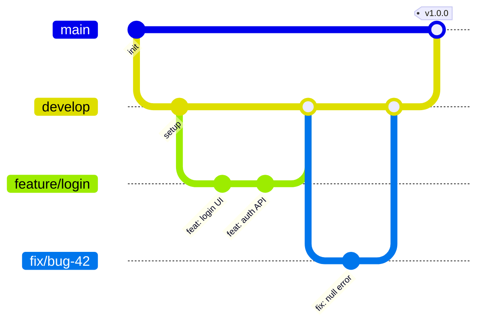

<!-- ============ HEADER (animated wave) ============ -->
<div align="center">


<a href="https://github.com/unezac">
  
</a>

<br/>


<br/><br/>

<a href="#-about-me">About</a> &nbsp;•&nbsp;
<a href="#-tech-stack">Stack</a> &nbsp;•&nbsp;
<a href="#-featured-projects">Projects</a> &nbsp;•&nbsp;
<a href="#-github-stats">Stats</a> &nbsp;•&nbsp;
<a href="#-contact">Contact</a>

</div>

---

## 👨‍💻 About Me


```js
const unezac = {
  location: "Kenitra, Morocco 🇲🇦",
  role: "Developer",
  currentlyWorkingOn: "Your main project here",
  currentlyLearning: ["TypeScript", "Docker", "System Design"],
  askMeAbout: ["Web Development", "Git & GitHub", "Clean Code"],
  funFact: "I debug with coffee ☕",
};
```

- 🔭 Currently building **[project name]**
- 🌱 Learning **[technology]**
- 🤝 Open to **collaborations & open-source contributions**
- ⚡ Passionate about clean code, UX, and automation

---

## 🛠 Tech Stack

<div align="center">

**Languages**


**Frameworks & Libraries**


**Databases & Cloud**


**Tools & DevOps**


</div>

> 💡 Edit the icons list in the URL (`?i=...`) — full list: [skillicons.dev](https://skillicons.dev)

---

## 📌 Featured Projects

<div align="center">

<a href="https://github.com/unezac/REPO_1">
  
</a>
<a href="https://github.com/unezac/REPO_2">
  
</a>
<br/>
<a href="https://github.com/unezac/REPO_3">
  
</a>
<a href="https://github.com/unezac/REPO_4">
  
</a>

</div>

> Replace `REPO_1` ... `REPO_4` with the real names of your repositories.

<details>
<summary><b>📂 More projects (click to expand)</b></summary>
<br/>

| Project | Description | Stack | Link |
| :-- | :-- | :-- | :-: |
| **Project A** | Short description | `React` `Node.js` | [🔗](https://github.com/unezac) |
| **Project B** | Short description | `Python` `Flask` | [🔗](https://github.com/unezac) |
| **Project C** | Short description | `PHP` `MySQL` | [🔗](https://github.com/unezac) |

</details>

---

## 📊 GitHub Stats

<div align="center">


</div>

### 🏆 Trophies

<div align="center">


</div>

### 📈 Contribution Activity

<div align="center">


</div>

### 🐍 Contribution Snake

<div align="center">

<picture>
  <source media="(prefers-color-scheme: dark)" srcset="https://raw.githubusercontent.com/unezac/unezac/output/github-snake-dark.svg" />
  <source media="(prefers-color-scheme: light)" srcset="https://raw.githubusercontent.com/unezac/unezac/output/github-snake.svg" />
  
</picture>

</div>

> 🐍 The snake needs a GitHub Action: see the **Setup** section at the bottom.

---

## 🔀 Git Workflow I Follow



<details>
<summary><b>📚 My Git cheat sheet</b></summary>
<br/>

```bash
# Start
git clone https://github.com/unezac/REPO.git
git checkout -b feature/my-feature

# Daily flow
git status
git add .
git commit -m "feat: add awesome feature"
git pull --rebase origin main
git push -u origin feature/my-feature

# Undo & fix
git restore <file>              # discard local changes
git reset --soft HEAD~1         # undo last commit, keep changes
git stash / git stash pop       # park work temporarily
git cherry-pick <commit>        # take one commit from another branch
```

**Commit convention (Conventional Commits)**

| Type | Meaning |
| :-- | :-- |
| `feat` | ✨ New feature |
| `fix` | 🐛 Bug fix |
| `docs` | 📝 Documentation |
| `style` | 💄 Formatting only |
| `refactor` | ♻️ Code restructuring |
| `test` | ✅ Tests |
| `chore` | 🔧 Maintenance / tooling |

</details>

---

## 🤝 Contributing

I welcome contributions. To contribute to any of my repositories:

1. 🍴 **Fork** the repo
2. 🌿 Create a branch: `git checkout -b feature/amazing-feature`
3. 💾 Commit: `git commit -m "feat: add amazing feature"`
4. 🚀 Push: `git push origin feature/amazing-feature`
5. 🔃 Open a **Pull Request**

---

## 📫 Contact

<div align="center">

<a href="mailto:your@email.com"></a>
<a href="https://linkedin.com/in/YOUR_LINKEDIN"></a>
<a href="https://twitter.com/YOUR_TWITTER"></a>
<a href="https://your-portfolio.com"></a>
<a href="https://instagram.com/YOUR_INSTAGRAM"></a>

<br/><br/>


</div>

---

<details>
<summary><b>⚙️ Setup: enable the snake animation (one time)</b></summary>
<br/>

Create the file `.github/workflows/snake.yml` in the `unezac/unezac` repo:

```yaml
name: Generate Snake

on:
  schedule:
    - cron: "0 0 * * *"
  workflow_dispatch:
  push:
    branches: [main]

permissions:
  contents: write

jobs:
  generate:
    runs-on: ubuntu-latest
    steps:
      - uses: Platane/snk/svg-only@v3
        with:
          github_user_name: ${{ github.repository_owner }}
          outputs: |
            dist/github-snake.svg
            dist/github-snake-dark.svg?palette=github-dark

      - uses: crazy-max/ghaction-github-pages@v3.1.0
        with:
          target_branch: output
          build_dir: dist
        env:
          GITHUB_TOKEN: ${{ secrets.GITHUB_TOKEN }}
```

Then go to **Actions → Generate Snake → Run workflow**.

</details>
