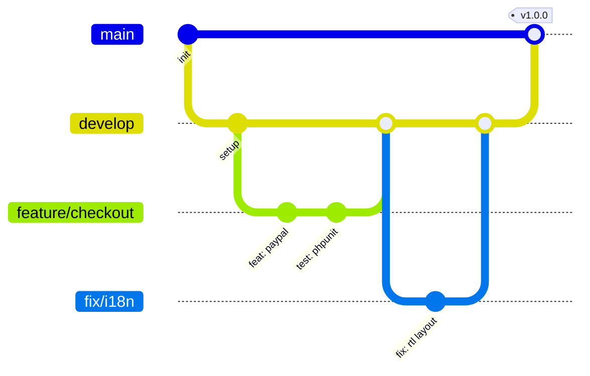

<div align="center">


<a href="https://github.com/unezac">
  
</a>

<br/>


<br/><br/>

<a href="#-about"><b>About</b></a> &nbsp;·&nbsp;
<a href="#-tech-stack"><b>Stack</b></a> &nbsp;·&nbsp;
<a href="#-featured-projects"><b>Projects</b></a> &nbsp;·&nbsp;
<a href="#-github-stats"><b>Stats</b></a> &nbsp;·&nbsp;
<a href="#-git-workflow"><b>Git</b></a> &nbsp;·&nbsp;
<a href="#-contact"><b>Contact</b></a>

</div>


## 👨‍💻 About

```js
const abdellah = {
  handle: "unezac",
  location: "Morocco 🇲🇦",
  role: "Full-Stack Developer",
  languages: ["Arabic", "French", "English", "German (learning)"],
  focus: ["E-commerce", "REST APIs", "Web security", "i18n & SEO"],
  currentlyBuilding: ["MANAHIL-ASL", "KeyGermany"],
  funFact: "I debug with coffee ☕ and ship with honey 🍯",
};
```

- 🛒 I build full e-commerce apps: catalog, cart, checkout, PayPal, admin
- 🌍 I care about multilingual products (Arabic RTL, French, English)
- 🔐 I write with security and testing in mind (PHPUnit, CI, HTTPS-first)
- 🤝 Open to collaborations, freelance and open-source


## 🛠 Tech Stack

<div align="center">

**Backend**


**Frontend**


**Tools & DevOps**


</div>


## 📌 Featured Projects

<div align="center">

<a href="https://github.com/unezac/hannymoney"></a>
<a href="https://github.com/unezac/keyde"></a>

</div>

<details>
<summary><b>🍯 MANAHIL-ASL</b> — details</summary>
<br/>

A lightweight PHP e-commerce app for selling premium Moroccan honey.

- **Architecture:** custom MVC (`controllers`, `models`, `services`, `middleware`, `validators`, `views`)
- **i18n:** Arabic (ar-MA) and French (fr-MA) with SEO-ready sitemap and robots.txt
- **Payments:** PayPal with webhook support
- **Quality:** PHPUnit and a GitHub Actions CI pipeline
- **PWA:** installable web manifest
- **Security:** documented in `docs/SECURITY.md`

```bash
git clone https://github.com/unezac/hannymoney.git && cd hannymoney
cp config/.env.example config/.env
composer install
mysql -u DB_USER -p DB_NAME < database/migrations/001_initial_schema.sql
php -S localhost:8000 -t public
```

</details>

<details>
<summary><b>⌨️ KeyGermany</b> — details</summary>
<br/>

A modern German typing practice app with real-time validation, speech synthesis and progress tracking.

- Accuracy tracking, A1 to C1 levels and category filters
- UI in German, English and Arabic, with audio pronunciation
- QWERTZ / QWERTY / AZERTY interactive keyboard
- Light, Dark and Soft themes, and an offline fallback mode
- REST API documented automatically at `/docs` (OpenAPI)

```bash
git clone https://github.com/unezac/keyde.git && cd keyde
pip install -r requirements.txt
uvicorn main:app --reload --host 127.0.0.1 --port 3000
```

</details>


## 📊 GitHub Stats

<div align="center">


<picture>
  <source media="(prefers-color-scheme: dark)" srcset="https://raw.githubusercontent.com/unezac/unezac/output/github-snake-dark.svg"/>
  <source media="(prefers-color-scheme: light)" srcset="https://raw.githubusercontent.com/unezac/unezac/output/github-snake.svg"/>
  
</picture>

</div>


## 🔀 Git Workflow



<details>
<summary><b>📚 Git cheat sheet & commit convention</b></summary>
<br/>

```bash
git checkout -b feature/my-feature     # new branch
git add . && git commit -m "feat: add awesome feature"
git pull --rebase origin main          # sync cleanly
git push -u origin feature/my-feature
git restore <file>                     # discard local changes
git reset --soft HEAD~1                # undo last commit, keep changes
git stash / git stash pop              # park work
git cherry-pick <commit>               # pick one commit
```

| Type | Meaning | Type | Meaning |
| :-- | :-- | :-- | :-- |
| `feat` | ✨ New feature | `docs` | 📝 Documentation |
| `fix` | 🐛 Bug fix | `refactor` | ♻️ Restructuring |
| `test` | ✅ Tests | `chore` | 🔧 Tooling / maintenance |

</details>

<details>
<summary><b>🤝 How to contribute to my repos</b></summary>
<br/>

1. 🍴 **Fork** the repository
2. 🌿 `git checkout -b feature/amazing-feature`
3. 💾 `git commit -m "feat: add amazing feature"`
4. 🚀 `git push origin feature/amazing-feature`
5. 🔃 Open a **Pull Request**

</details>


## 📫 Contact

<div align="center">

<a href="https://github.com/unezac"></a>
<!-- Add yours, then remove this comment:
<a href="mailto:YOUR_EMAIL"></a>
<a href="https://linkedin.com/in/YOUR_ID"></a>
-->


</div>
